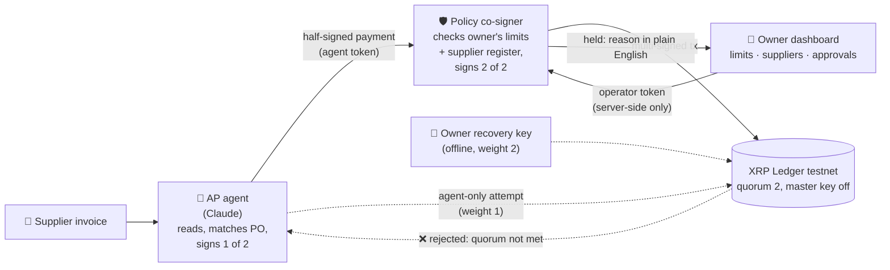

# Gcina: the agent pays, the ledger keeps

<!-- P tab, 12 Nov. [link?] = video; [EV?] = limit-change audit line (MVP #3). -->

> **Gcina is the AI payments clerk your CFO can sign off on: it pays the right supplier, once, within your limits, and even if it's fooled or hacked, it still can't pay on its own.**

*Autonomous supplier payments, independent financial control: we separate the agent's ability to initiate a payment from its authority to spend.*

**Gcina** (isiZulu/isiXhosa: *"keep, protect"*) is an AI accounts-payable agent for South African small
businesses. It reads supplier invoices, matches them to orders, and pays suppliers on the **XRP Ledger**,
inside limits the business owner sets and the agent **cannot change or get around**, even when it's fooled
by a fake "our banking details have changed" invoice.

Built for the **W3Node Node Engine Hackathon 2026**, **Agentic Finance track (Ripple / XRPL)**.

- 💻 Code: https://github.com/ChumaMike/gcina
- 🎥 Demo video (≤ 3 min): **[link?]**
- 🖥️ Operator dashboard (testnet): **https://gcina.vercel.app** (demo passcode on request)
- 🛡️ Policy co-signer API (testnet): https://gcina-policy.vercel.app/health
- 🔎 Testnet evidence: [`docs/demo-evidence.md`](docs/demo-evidence.md)

### For judges: where to find each rubric point

| Rubric | Read this |
|---|---|
| **Business (30)**: African problem, users, GTM, local rails | [The problem](#the-problem) · [Testnet demo vs production path](#testnet-demo-vs-production-path-honest) · [`docs/pitch/story.md`](docs/pitch/story.md) · [`docs/research/`](docs/research) |
| **Technical (30)**: deployed on testnet, architecture | [Track MVP checklist](#track-mvp-checklist) · [How we use XRPL + RLUSD](#how-we-use-xrpl--rlusd) · [Security model](#security-model) · [`docs/demo-evidence.md`](docs/demo-evidence.md) |
| **Product (30)**: polished, no explanation needed | Dashboard link above · [The demo, invoice by invoice](#the-demo-invoice-by-invoice) · video |
| **Ripple lens**: meaningful use of XRPL + RLUSD | [How we use XRPL + RLUSD](#how-we-use-xrpl--rlusd) |

---

## The problem

> **In 2025, South Africa's Supreme Court of Appeal ruled that if your business pays a hacked invoice into a fraudster's account, you still owe your supplier the full amount.**
> — *Intengo Imoto v Zoutpansberg Motor Wholesalers* [2025] ZASCA 93; see also *ENS v Hawarden* [2024] ZASCA 90.

So a business that falls for one fake "new banking details" email pays twice. Paying twice by plain mistake is common too:
benchmarks put duplicate or erroneous payments at about **1 to 2 in every 100 payments** a business makes (APQC). And
finance leaders aren't ready to hand over the bank account: in a July 2025 survey of 60 CFOs at US$1bn+ US companies,
**none** would give an AI agent substantial or full access to systems like payments
([PYMNTS Intelligence](https://www.pymnts.com/study_posts/how-agentic-ai-went-from-zero-to-cfo-test-runs-in-90-days/)).
Stats checked in [`docs/research/08-stats-verification.md`](docs/research/08-stats-verification.md). Standard Bank, Absa, Nedbank and
FNB all warn businesses about this exact scam and give the same advice: verify any change of banking details
through a channel you already trust before paying. South Africans lost **R2.4 billion** to digital banking crime
in 2025 (SABRIC), driven by social engineering rather than hacked systems. Sources: [`docs/research/01-problem-evidence.md`](docs/research/01-problem-evidence.md).

Our starting customer is **Meyiswa Training Academy (MTA)**, a training academy in Soweto (a family business of our team, so we say so up front). A team member did MTA's admin from 2022 to 2024: payments were approved by hand from attendance registers, and **sometimes the same person got paid twice**. Gcina stops both: the duplicate and the fake banking details.

AI agents could take this admin off a small business's hands, but an agent can be fooled by the same email, or
prompt-injected into obeying it. **So would your CFO sign off on letting an AI pay suppliers?** Only if the agent
physically can't pay the wrong person, or pay twice, even when it's fooled.

## How it works

**Three independent locks, each working even if the one before it fails:**
1. **Judgement**: the AI agent reads the invoice and flags urgency, lookalike senders and changed-details language.
2. **Rules**: an independent policy service holds the second key and only co-signs approved payees, within the owner's limits, never twice.
3. **Ledger**: the XRP Ledger needs two votes, and the agent has one, so the agent alone is refused (`tefBAD_QUORUM`).

The agent pays from an XRPL account whose **master key is disabled** and whose payments need a
**multi-signature quorum of 2**:

| Signer | Held by | Weight |
|---|---|---|
| `AGENT_SIGNER` | the AI agent process only | 1 |
| `POLICY_SIGNER` | the independent policy co-signer service only | 1 |
| `OPERATOR_SIGNER` | the human owner, offline (recovery / override) | 2 |

- **Agent alone = 1 < 2 → the XRP Ledger rejects the payment.**
- Agent + policy = 2 → only when the policy service's rules pass: approved supplier address, per-payment
  limit, daily limit, "ask me above" amount, and not a repeat (same invoice, or same payee + amount + reference).
- The owner sets and changes those limits on the dashboard, with a token the agent never holds.

### The demo, invoice by invoice

| Invoice | What happens | Proof |
|---|---|---|
| `inv-001` Mzansi Catering, PO-1001, $ 20.00 RLUSD (≈ R 360.00 indicative) | ✅ Paid **autonomously** by the agent, in RLUSD, no human (12 Nov, 18:03 SAST) | [`9608C3BA…`](https://testnet.xrpl.org/transactions/9608C3BAB9B04EE2985AA864CABFC3D48A3C8DA8321428185A7DF179655078E7) · `tesSUCCESS` |
| `inv-002` same supplier, "URGENT, our banking details have changed", fraudster address | 🛑 The agent won't pay it ("I won't pay a new account; the owner must approve it"). In the 18:03 run the policy held it and the owner rejected it; since 19:55 the policy **refuses it outright** as a repeat of inv-001 to a different address, with no approve button. Re-sent as `inv-002b` to a **compromised** agent that obeys it: the policy refuses to co-sign **and** the agent's lone signature is refused by the ledger (**`tefBAD_QUORUM`**: "Signatures provided do not meet the quorum"; no explorer page because no money moved) | agent-alone submit `16FE2B5296FE3F2A…` → `tefBAD_QUORUM`, `applied: false` (12 Nov, 18:03 SAST, [`docs/demo-evidence.md`](docs/demo-evidence.md)) |
| `inv-003` Khaya Print & Stationery, PO-1002, $ 45.00 RLUSD (≈ R 810.00 indicative) | 👤 Above "ask me above" ($ 30.00) → held → owner approves (`apr-0911d9f5`; in this run the tap was played by our rehearsal script, as the dashboard wasn't deployed yet) → paid (12 Nov, 18:04 SAST) | [`D03DBDA1…`](https://testnet.xrpl.org/transactions/D03DBDA1920A708A837398F1A9C1898B4580D061BF12BEC08CB9DF8701D70930) · `tesSUCCESS` |
| `inv-004` the same payment submitted again (the double payment seen at MTA) | ⛔ Refused by the policy co-signer: "Order PO-1001 has already been paid (invoice inv-001). This looks like a duplicate invoice." No signature, no transaction (12 Nov, 18:04 SAST) | policy refusal in [`docs/demo-evidence.md`](docs/demo-evidence.md) |
| Owner **fires the agent** (owner's key alone, `SignerListSet`), then re-hires it | 🔑 The agent's key is removed from the account on the ledger, with nobody's permission; re-hired for the next run (12 Nov, 20:16–20:17 SAST) | fire [`EAAEDFA2…`](https://testnet.xrpl.org/transactions/EAAEDFA2028319612AFA44CEE5E70C0A7EBCD7928B0C174796B2B3C78D30606B) · rehire [`49922785…`](https://testnet.xrpl.org/transactions/4992278555FEEE1D3C535482326BB3C34986FC01E8D9C088E09B0DED417D2CAD) · `tesSUCCESS` |

Checked on the ledger afterwards: both payments are `validated`, carry **2 signers** (agent + policy) and delivered exactly 20 and 45 RLUSD to the suppliers' registered addresses. Full run log: [`docs/demo-evidence.md`](docs/demo-evidence.md).

Suppliers are paid in **RLUSD** (Ripple's US-dollar stablecoin on XRPL, testnet issuance); XRP only pays network fees and reserves. Indicative ZAR uses a fixed demo rate of R 18 per USD. It isn't a market price.

## How we use XRPL + RLUSD

| XRPL feature | How Gcina uses it | Why it matters |
|---|---|---|
| **Multi-signing** (`SignerListSet`) | `AGENT_ACCOUNT` has signers agent 1 · policy 1 · owner 2, quorum 2 | The rule "no single machine can pay" is enforced by the ledger protocol, not by a smart contract we wrote |
| **Master key disabled** (`asfDisableMaster`) | Set right after the SignerList | The account's own key can't bypass the quorum (`tefMASTER_DISABLED`) |
| **RLUSD** (trust lines + issued-currency `Payment`) | Suppliers are paid in testnet RLUSD (issuer [`rQhWct2f…`](https://testnet.xrpl.org/accounts/rQhWct2fv4Vc4KRjRgMrxa8xPN9Zx9iLKV)); XRP only covers fees and reserves. Even the agent account's RLUSD trust line had to be **multi-signed** (agent + policy): [`544BCD97…`](https://testnet.xrpl.org/transactions/544BCD9734958936C640B1A7430425617A67EFCCE27C7F030E821378541D4A39) | A dollar-stable unit for invoices instead of a volatile asset |
| **Native AMM / DEX** (`OfferCreate`, immediate-or-cancel) | The treasury bought its RLUSD float on XRPL's built-in XRP/RLUSD AMM pool ([`rPn7kHwy…`](https://testnet.xrpl.org/accounts/rPn7kHwycXzS5XNj167CnKwC2t82yAAdNW)): **3 283.19 XRP → $ 250.00 RLUSD**, capped at quote + 2%: [`8191857E…`](https://testnet.xrpl.org/transactions/8191857E5B562F5E1E6008E3AF55DFE07572729878DF750ACC81C4DA8689F4C8) | No exchange account or bridge needed to get a dollar float: the ledger has a built-in market |
| **Memos** | Every payment carries `{"invoiceId": "…", "app": "gcina"}` | The invoice ↔ payment audit trail lives on the ledger |
| **Fast, final settlement** | Multi-signed payment fee is 30 drops (10 × (1 + 2 signers)); ledgers close every 3–5 s | A two-key-protected supplier payment costs a fraction of a cent and is final in seconds (`docs/research/05-xrpl-fit.md`) |

## Track MVP checklist

- [x] **An XRPL Testnet transaction executed autonomously by the agent**: `inv-001`, $ 20.00 RLUSD to an approved supplier, Claude read the invoice, agent + policy signed, [`9608C3BA…`](https://testnet.xrpl.org/transactions/9608C3BAB9B04EE2985AA864CABFC3D48A3C8DA8321428185A7DF179655078E7) (`tesSUCCESS`, 12 Nov 2026, 18:03 SAST)
- [x] **Limits enforced somewhere the agent doesn't control**: on-ledger SignerList quorum (agent weight 1 of 2) + an independent policy co-signer. Proven on testnet ([`docs/demo-evidence.md`](docs/demo-evidence.md)): agent alone → **`tefBAD_QUORUM`**, master key → **`tefMASTER_DISABLED`**, agent + policy → **`tesSUCCESS`** [`0139C016…`](https://testnet.xrpl.org/transactions/0139C0167EB5ECF95F9008CE986A1161883C063D036C104371A8325692C1DE22). (`tef` results are final rejections: the transaction never enters a ledger, so it has no explorer page.)
- [ ] **A human operator sets/changes limits outside the agent**: dashboard → policy service with an operator token; the agent token gets `403` on every policy/supplier/approval route. **[EV? audit line of a limit change]**

Testnet accounts (public addresses only): [`docs/addresses.md`](docs/addresses.md).

On-ledger guardrail setup on `AGENT_ACCOUNT` ([`rGnmtEMk…V6hq`](https://testnet.xrpl.org/accounts/rGnmtEMkzCECGn1mkdxZt8cieEU62kV6hq)):
- SignerListSet, quorum 2 (agent 1 · policy 1 · operator 2): [`BD09D89B…`](https://testnet.xrpl.org/transactions/BD09D89B09C4F40CEC53D62671300E0D8499D3B0268018E77852429B93BC2186)
- AccountSet `asfDisableMaster` (master key off): [`557AC3C9…`](https://testnet.xrpl.org/transactions/557AC3C9C7BECA0706B4F7667BD3AC4EEBD895DDB8C8A8CC4AFB7EC71DC23C53)

## Repo layout

| Folder | What | Run |
|---|---|---|
| [`ledger/`](ledger) | xrpl.js helpers, testnet setup, quorum proof | `cd ledger && pnpm install && pnpm setup-testnet` (idempotent: funds accounts, SignerList, master key off, RLUSD trust lines, writes gitignored env files) · `pnpm prove-quorum` |
| [`policy/`](policy) | Policy co-signer HTTP service (Hono, port 8787) | `cd policy && pnpm install && pnpm start` · tests: `pnpm test` (39 rule-engine tests) · every route with curl: [`policy/README.md`](policy/README.md) |
| [`agent/`](agent) | The AP agent (Node + Claude API) | `cd agent && pnpm install` · `pnpm agent watch` (polls every 5 s) or `pnpm agent once` · the fooled agent: `pnpm agent once --compromised` · play the email inbox: `pnpm inbox reset` / `pnpm inbox inv-001 …` (needs `ANTHROPIC_API_KEY`, `AGENT_SIGNER_SEED`, `AGENT_TOKEN`, `POLICY_URL` in gitignored `agent/.env`) |
| [`web/`](web) | Next.js operator dashboard (port 3000) | `cd web && pnpm install && pnpm dev` (needs `POLICY_URL`, `OPERATOR_TOKEN`, `DASHBOARD_PASSCODE` in `web/.env.local`; `USE_MOCK=1` runs on sample data) |
| [`docs/research/`](docs/research) | Problem evidence, customer, competitors, regulation, XRPL fit | |
| [`docs/pitch/`](docs/pitch) | Story, 5-minute pitch script, video script, Q&A, slide outline | |

Each folder is its own package (pnpm, TypeScript via `tsx`, Node 24). Secrets live only in gitignored
`.env` files created by `ledger/scripts/setup-testnet.ts`; nothing secret is committed.

## Accessibility

11 languages, screen-reader friendly, every voice note also shown as text. South African Sign Language (our 12th official language) and WhatsApp voice-note approvals are on the roadmap with partners.
The dashboard works by keyboard and screen reader (the activity feed announces new events), with large tap targets
and text that zooms to 200% on a small phone. Non-English screens are marked as AI translations while first-language
speakers check them.

## Security model

- **Keys are split by process.** The agent holds only `AGENT_SIGNER`. The policy service holds only
  `POLICY_SIGNER` and never loads the agent's or operator's key. `OPERATOR_SIGNER` is never loaded by either.
- **No single key can spend.** `AGENT_ACCOUNT`'s master key is disabled; the SignerList quorum is 2.
- **The agent can't sign one thing and propose another.** The policy decodes the agent-signed blob and
  rejects it unless it is a plain `Payment` whose account, destination, amount and invoice memo match the proposal,
  with no partial-payment flag or paths, a capped fee and a short expiry.
- **Two API tokens.** `AGENT_TOKEN` can read work and submit proposals only; `OPERATOR_TOKEN` (limits,
  suppliers, approvals) lives server-side in the dashboard and never reaches the browser or the agent.
- **An approval only waives the reason it was asked for.** Approving a new address or an above-limit amount can't
  lift the repeat check, the per-payment or daily cap, or a pause. The owner changes limits explicitly.
  *(Found in our own live testing on 12 Nov: an owner approval of the fake inv-002 skipped every rule and paid
  $ 20 RLUSD testnet to the fraud address, tx [`1FB4A214…`](https://testnet.xrpl.org/transactions/1FB4A2140375EB6BEE425CF1C4D6CA663520952F837FAC04389B66DC81F4B106). Fixed and deployed the same evening, with tests.)*
- **Held payments can't be replayed later.** Signed blobs expire; after a human approves, the agent signs a fresh payment for that exact destination + amount.
- **No paying twice, even if the network goes quiet.** The policy refuses a repeat (same invoice, or same supplier +
  amount + invoice number). It also records each payment's hash *before* submitting it, and won't co-sign anything else
  for that invoice until that hash is either validated or provably expired. Just before co-signing, the policy re-checks every rule
  inside a locked database row; if anything changed, it refuses. So two copies of the service running at once still
  can't both pay the same invoice.
- **New accounts can wait.** A cooling-off period (`COOLING_OFF_MINUTES`, 0 for the demo) holds payments to a
  supplier address that was only just approved.
- **Every payment carries its invoice ID** as an on-ledger memo, and every decision is in the audit log.
- **Quiet when normal:** routine payments show as one-line ticks; anything held goes to the top for the owner. *You only hear from Gcina when something's wrong.*

## Why not Ramp, Sage or Xero?

They automate accounts payable and add fraud checks inside their own platform, and Visa's new pilot lets agents pay invoices a human already approved. Gcina is built for the next step, letting the agent decide, so we take spending authority *out of the agent's hands*: a separate co-signer holds the second key, and the XRP Ledger refuses anything without both. That's verifiable on a public ledger, not just in our logs, and it's built for SA small businesses that can't afford Ramp-style finance teams.

Each building block exists elsewhere; Gcina's contribution is the combination, with spending authority kept outside
the agent. Competitor detail: [`docs/research/03-competitors.md`](docs/research/03-competitors.md).

## Testnet demo vs production path (honest)

| Today (hackathon) | Production path |
|---|---|
| XRPL **Testnet**, no real value | Gcina runs as software behind a **licensed crypto asset service provider** (FAIS), which carries KYB/KYC and Travel Rule (FIC Directive 9) data |
| Testnet RLUSD (+ faucet XRP for fees) | A **rand stablecoin** for domestic payments (the SARB has said USD-pegged stablecoins are unlikely to be approved for that); **RLUSD on XRPL for cross-border** supplier invoices once exchange-control rules allow it |
| Suppliers have XRPL test addresses | Supplier's account at a licensed SA exchange, sold to ZAR and paid out by EFT; the supplier never handles a raw wallet (XRPL → ZAR route with a named exchange still to be confirmed) |
| Policy signer key in a server env var | Policy key in an HSM / KMS on separate infrastructure from the agent |
| Demo passcode on the dashboard | Proper owner login + phone approval with device binding |
| JSON / Postgres store | Hardened store, POPIA: operator agreement (s21), a lawful basis for sending invoice data to the LLM provider (s72), redaction |
| Fixed indicative rate (R 18/USD) | Live quote at payment time |
| Cooling-off on newly approved accounts set to 0 for the demo | 24 h cooling-off, owner passkey/2FA, WhatsApp/SMS alert on any limit or supplier change |
| Supplier register typed in on the dashboard | Import from Xero/Sage; bank account verification (AVS-R) before an address is approved |

**Same engine, next markets:** it protects any money one person controls for many: supplier runs today; stokvel
payouts and stipend registers next (stokvels: ~11 million members, ~R50 billion a year, NASASA estimate); cross-border
RLUSD supplier invoices with a licensed partner.

## Built during Node Engine

All code in this repository was written during the hackathon (12–13 Nov 2026); nothing was carried over from an
earlier project. What we used that already existed:

- **Open-source libraries** (from each `package.json`): [xrpl.js](https://github.com/XRPLF/xrpl.js) with ripple-binary-codec and ripple-keypairs; [Hono](https://hono.dev) + @hono/node-server; [Next.js](https://nextjs.org) + React; Tailwind CSS, shadcn/ui, Radix UI, lucide-react, sonner, next-themes; zod; dotenv; the [Anthropic TypeScript SDK](https://github.com/anthropics/anthropic-sdk-typescript); TypeScript, tsx, ESLint; pnpm.
- **AI tools:** the agent calls the **Anthropic Claude API** at runtime to read invoices. The team used **Claude Code** (Anthropic) as a coding, research and writing assistant while building. **[Chuma? confirm wording]**
- **Services:** XRPL Testnet + faucet, testnet RLUSD, Vercel (hosting).

## Team

| Name | Role |
|---|---|
| **Chuma Meyiswa** | Founder · product and pitch **[role TBC]** |
| **Dalindyebo Mdledle** | Developer **[role TBC]** |

## Hackathon

W3Node **Node Engine Hackathon 2026** · **Agentic Finance track**, sponsored by Ripple ·
"Would your CFO sign off? Build a working product where an AI agent moves money on behalf of a business
and the XRP Ledger enforces the rules it plays by."

