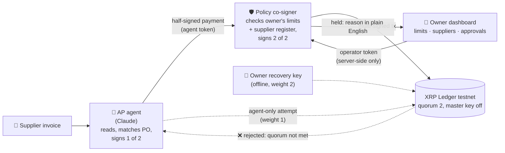

# Gcina: the agent pays, the ledger keeps

<!-- DRAFT v0 (P tab, 12 Nov). [R?] = waiting on docs/research, [EV?] = waiting on docs/demo-evidence.md. Final after the 23:00 testnet run. -->

**Gcina** (isiZulu/isiXhosa: *"keep, protect"*) is an AI accounts-payable agent for South African small
businesses. It reads supplier invoices, matches them to orders, and pays suppliers on the **XRP Ledger**,
inside limits the business owner sets and the agent **cannot change or get around**, even when it's fooled
by a fake "our banking details have changed" invoice.

Built for the **W3Node Node Engine Hackathon 2026**, **Agentic Finance track (Ripple / XRPL)**.

- 🎥 Demo video (≤ 3 min): **[link?]**
- 🖥️ Operator dashboard (testnet): **[deployed URL?]** (demo passcode on request)
- 🔎 Testnet evidence: [`docs/demo-evidence.md`](docs/demo-evidence.md)

---

## The problem

**[R? 30-second problem + 1 headline stat with source and year, from docs/research/00-verdict.md]**

A small business pays its suppliers by bank transfer against invoices. Fraudsters send convincing
"new banking details" invoices and the business pays them instead. AI agents can now do accounts payable,
but an agent can be fooled by the same email, or prompt-injected into obeying it.
**So would your CFO sign off on letting an AI pay suppliers?** Only if the agent physically can't pay the
wrong person.

Our first design partner is a food business owner we already work with: Gumede, owner of Kota~tainment.
**[R? one line from the interview]**

## How it works

The agent pays from an XRPL account whose **master key is disabled** and whose payments need a
**multi-signature quorum of 2**:

| Signer | Held by | Weight |
|---|---|---|
| `AGENT_SIGNER` | the AI agent process only | 1 |
| `POLICY_SIGNER` | the independent policy co-signer service only | 1 |
| `OPERATOR_SIGNER` | the human owner, offline (recovery / override) | 2 |

- **Agent alone = 1 < 2 → the XRP Ledger rejects the payment.**
- Agent + policy = 2 → only when the policy service's rules pass (approved supplier address, per-payment
  limit, daily limit, "ask a human above").
- The owner sets and changes those limits on the dashboard, with a token the agent never holds.

### The demo, invoice by invoice

| Invoice | What happens | Proof |
|---|---|---|
| `inv-001` Mzansi Meat Supplies, PO-1001, 20 XRP (≈ R 800.00 indicative) | ✅ Paid **autonomously** by the agent | **[EV? tx link]** |
| `inv-002` same supplier, "URGENT, our banking details have changed", fraudster address | 🛑 Agent flags it and holds it; in **compromised mode** the policy refuses **and** the agent's direct single-signature submit is rejected by the ledger (**[EV? engine result]**) | **[EV? link / log]** |
| `inv-003` Khaya Packaging, PO-1002, 45 XRP (≈ R 1 800.00 indicative) | 👤 Above "ask me above" → held → owner approves on phone → paid | **[EV? tx link]** |
| `inv-004` duplicate of inv-001 | ⛔ Rejected as already paid | **[EV? audit line]** |

Indicative ZAR uses a fixed demo rate of R 40 per XRP. It isn't a market price.

## Track MVP checklist

- [ ] **An XRPL Testnet transaction executed autonomously by the agent**: **[EV? inv-001 hash link]**
- [ ] **Limits enforced somewhere the agent doesn't control**: on-ledger SignerList quorum (agent weight 1 of 2) + an independent policy co-signer. Ledger rejection of an agent-only payment: **[EV?]**
- [ ] **A human operator sets/changes limits outside the agent**: dashboard → policy service with an operator token; the agent token gets `403` on every policy/supplier/approval route. **[EV? audit line of a limit change]**

Testnet accounts (public addresses only): [`docs/addresses.md`](docs/addresses.md).

## Repo layout

| Folder | What | Run |
|---|---|---|
| [`ledger/`](ledger) | xrpl.js helpers, testnet setup, quorum proof | **[run commands from L?]** |
| [`policy/`](policy) | Policy co-signer HTTP service (Hono, port 8787) | **[run commands from L?]** |
| [`agent/`](agent) | The AP agent (Node + Claude API) | **[run commands from A?]** |
| [`web/`](web) | Next.js operator dashboard (port 3000) | **[run commands from W?]** |
| [`docs/research/`](docs/research) | Problem evidence, customer, competitors, regulation, XRPL fit | |
| [`docs/pitch/`](docs/pitch) | Story, pitch script, video script, Q&A | |

Each folder is its own package (pnpm, TypeScript via `tsx`, Node 24). Secrets live only in gitignored
`.env` files created by `ledger/scripts/setup-testnet.ts`; nothing secret is committed.

## Security model

- **Keys are split by process.** The agent holds only `AGENT_SIGNER`. The policy service holds only
  `POLICY_SIGNER` and never loads the agent's or operator's key. `OPERATOR_SIGNER` is never loaded by either.
- **No single key can spend.** `AGENT_ACCOUNT`'s master key is disabled; the SignerList quorum is 2.
- **The agent can't sign one thing and propose another.** The policy decodes the agent-signed blob and
  rejects it unless account, destination, amount and invoice memo all match the proposal.
- **Two API tokens.** `AGENT_TOKEN` can read work and submit proposals only; `OPERATOR_TOKEN` (limits,
  suppliers, approvals) lives server-side in the dashboard and never reaches the browser or the agent.
- **Held payments can't be replayed later.** Signed blobs expire; after a human approves, the agent signs a fresh payment for that exact destination + amount.
- **Every payment carries its invoice ID** as an on-ledger memo, and every decision is in the audit log.

## Testnet demo vs production path (honest)

| Today (hackathon) | Production path |
|---|---|
| XRPL **Testnet**, test XRP from the faucet | RLUSD on XRPL mainnet **[R? rails partner + licensing from 04-regulation-and-rails.md]** |
| Suppliers have XRPL test addresses | Suppliers keep receiving **rands in their bank account** via a licensed off-ramp partner **[R?]** |
| Policy signer key in a server env var | Policy key in an HSM / KMS on separate infrastructure from the agent |
| Demo passcode on the dashboard | Proper owner login + phone approval with device binding |
| JSON / Postgres store | Hardened store, POPIA-compliant handling of invoice data **[R?]** |
| Fixed indicative rate (R 40/XRP) | Live quote at payment time |

## Team

**[Chuma? names + roles only, no contact details]**

## Hackathon

W3Node **Node Engine Hackathon 2026** · **Agentic Finance track**, sponsored by Ripple ·
"Would your CFO sign off? Build a working product where an AI agent moves money on behalf of a business
and the XRP Ledger enforces the rules it plays by."

All code in this repository was written during the hackathon.
