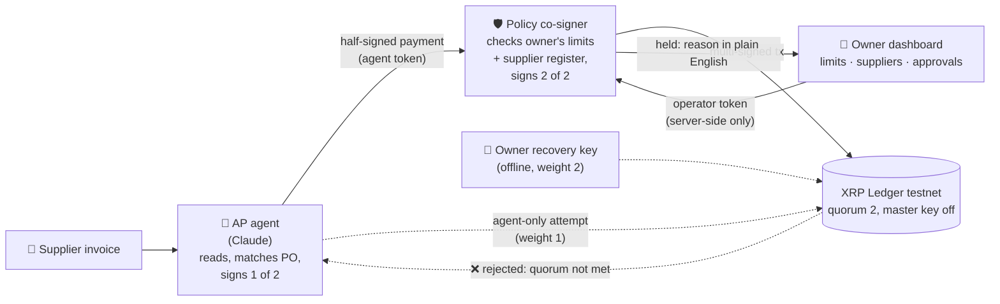

# Gcina: the agent pays, the ledger keeps

<!-- DRAFT v0 (P tab, 12 Nov). [R?] = waiting on docs/research, [EV?] = waiting on docs/demo-evidence.md. Final after the 23:00 testnet run. -->

**Gcina** (isiZulu/isiXhosa: *"keep, protect"*) is an AI accounts-payable agent for South African small
businesses. It reads supplier invoices, matches them to orders, and pays suppliers on the **XRP Ledger**,
inside limits the business owner sets and the agent **cannot change or get around**, even when it's fooled
by a fake "our banking details have changed" invoice.

Built for the **W3Node Node Engine Hackathon 2026**, **Agentic Finance track (Ripple / XRPL)**.

- 🎥 Demo video (≤ 3 min): **[link?]**
- 🖥️ Operator dashboard (testnet): **[deployed URL?]** (demo passcode on request)
- 🔎 Testnet evidence: [`docs/demo-evidence.md`](docs/demo-evidence.md)

### For judges: where to find each rubric point

| Rubric | Read this |
|---|---|
| **Business (30)**: African problem, users, GTM, local rails | [The problem](#the-problem) · [Testnet demo vs production path](#testnet-demo-vs-production-path-honest) · [`docs/pitch/story.md`](docs/pitch/story.md) · [`docs/research/`](docs/research) |
| **Technical (30)**: deployed on testnet, architecture | [Track MVP checklist](#track-mvp-checklist) · [How we use XRPL + RLUSD](#how-we-use-xrpl--rlusd) · [Security model](#security-model) · [`docs/demo-evidence.md`](docs/demo-evidence.md) |
| **Product (30)**: polished, no explanation needed | Dashboard link above · [The demo, invoice by invoice](#the-demo-invoice-by-invoice) · video |
| **Ripple lens**: meaningful use of XRPL + RLUSD | [How we use XRPL + RLUSD](#how-we-use-xrpl--rlusd) |

---

## The problem

> **In 2025, South Africa's Supreme Court of Appeal ruled that if your business pays a hacked invoice into a fraudster's account, you still owe your supplier the full amount.**
> — *Intengo Imoto v Zoutpansberg Motor Wholesalers*, 2025 (6) SA 143 (SCA); see also *ENS v Hawarden* [2024] ZASCA 90.

So a business that falls for one fake "new banking details" email pays twice. Standard Bank, Absa, Nedbank and
FNB all warn businesses about this exact scam and give the same advice: verify any change of banking details
through a channel you already trust before paying. South Africans lost **R2.4 billion** to digital banking crime
in 2025 (SABRIC), driven by social engineering rather than hacked systems. Sources: [`docs/research/01-problem-evidence.md`](docs/research/01-problem-evidence.md).

A small business pays its suppliers by bank transfer against invoices. Fraudsters send convincing
"new banking details" invoices and the business pays them instead. AI agents can now do accounts payable,
but an agent can be fooled by the same email, or prompt-injected into obeying it.
**So would your CFO sign off on letting an AI pay suppliers?** Only if the agent physically can't pay the
wrong person.

Our first design partner is **Meyiswa Training Academy (MTA)**, a training academy in Soweto (a family business of our team, so we say so up front). A team member did MTA's admin from 2022 to 2024: payments were approved by hand from attendance registers, and **sometimes the same person got paid twice**. Gcina stops both: the duplicate and the fake banking details.

## How it works

The agent pays from an XRPL account whose **master key is disabled** and whose payments need a
**multi-signature quorum of 2**:

| Signer | Held by | Weight |
|---|---|---|
| `AGENT_SIGNER` | the AI agent process only | 1 |
| `POLICY_SIGNER` | the independent policy co-signer service only | 1 |
| `OPERATOR_SIGNER` | the human owner, offline (recovery / override) | 2 |

- **Agent alone = 1 < 2 → the XRP Ledger rejects the payment.**
- Agent + policy = 2 → only when the policy service's rules pass (approved supplier address, per-payment
  limit, daily limit, "ask a human above").
- The owner sets and changes those limits on the dashboard, with a token the agent never holds.

### The demo, invoice by invoice

| Invoice | What happens | Proof |
|---|---|---|
| `inv-001` Mzansi Catering, PO-1001, $ 20.00 RLUSD (≈ R 360.00 indicative) | ✅ Paid **autonomously** by the agent | **[EV? tx link]** |
| `inv-002` same supplier, "URGENT, our banking details have changed", fraudster address | 🛑 Agent flags it and holds it; in **compromised mode** the policy refuses **and** the agent's direct single-signature submit is rejected by the ledger (**`tefBAD_QUORUM`**) | **[EV? link / log]** |
| `inv-003` Khaya Print & Stationery, PO-1002, $ 45.00 RLUSD (≈ R 810.00 indicative) | 👤 Above "ask me above" → held → owner approves on phone → paid | **[EV? tx link]** |
| `inv-004` the same payment submitted again (the double payment seen at MTA) | ⛔ Rejected by the policy co-signer as already paid | **[EV? audit line]** |

Suppliers are paid in **RLUSD** (Ripple's US-dollar stablecoin on XRPL, testnet issuance); XRP only pays network fees and reserves. Indicative ZAR uses a fixed demo rate of R 18 per USD. It isn't a market price.

## How we use XRPL + RLUSD

| XRPL feature | How Gcina uses it | Why it matters |
|---|---|---|
| **Multi-signing** (`SignerListSet`) | `AGENT_ACCOUNT` has signers agent 1 · policy 1 · owner 2, quorum 2 | The rule "no single machine can pay" is enforced by the ledger protocol, not by a smart contract we wrote |
| **Master key disabled** (`asfDisableMaster`) | Set right after the SignerList | Nobody can bypass the quorum with the account's own key (`tefMASTER_DISABLED`) |
| **RLUSD** (trust lines + issued-currency `Payment`) | Suppliers are paid in testnet RLUSD (issuer [`rQhWct2f…`](https://testnet.xrpl.org/accounts/rQhWct2fv4Vc4KRjRgMrxa8xPN9Zx9iLKV)); XRP only covers fees and reserves. Even the agent account's RLUSD trust line had to be **multi-signed** (agent + policy): [`544BCD97…`](https://testnet.xrpl.org/transactions/544BCD9734958936C640B1A7430425617A67EFCCE27C7F030E821378541D4A39) | A dollar-stable unit for invoices instead of a volatile asset |
| **Memos** | Every payment carries `{"invoiceId": "…", "app": "gcina"}` | The invoice ↔ payment audit trail lives on the ledger |
| **Fast, final settlement** | Multi-signed payment fee is 30 drops (10 × (1 + 2 signers)); ledgers close every 3–5 s | A two-key-protected supplier payment costs a fraction of a cent and is final in seconds (`docs/research/05-xrpl-fit.md`) |

## Track MVP checklist

- [ ] **An XRPL Testnet transaction executed autonomously by the agent**: **[EV? inv-001 hash link]**
- [x] **Limits enforced somewhere the agent doesn't control**: on-ledger SignerList quorum (agent weight 1 of 2) + an independent policy co-signer. Proven on testnet ([`docs/demo-evidence.md`](docs/demo-evidence.md)): agent alone → **`tefBAD_QUORUM`**, master key → **`tefMASTER_DISABLED`**, agent + policy → **`tesSUCCESS`** [`0139C016…`](https://testnet.xrpl.org/transactions/0139C0167EB5ECF95F9008CE986A1161883C063D036C104371A8325692C1DE22). (`tef` results are final rejections: the transaction never enters a ledger, so it has no explorer page.)
- [ ] **A human operator sets/changes limits outside the agent**: dashboard → policy service with an operator token; the agent token gets `403` on every policy/supplier/approval route. **[EV? audit line of a limit change]**

Testnet accounts (public addresses only): [`docs/addresses.md`](docs/addresses.md).

On-ledger guardrail setup on `AGENT_ACCOUNT` ([`rGnmtEMk…V6hq`](https://testnet.xrpl.org/accounts/rGnmtEMkzCECGn1mkdxZt8cieEU62kV6hq)):
- SignerListSet, quorum 2 (agent 1 · policy 1 · operator 2): [`BD09D89B…`](https://testnet.xrpl.org/transactions/BD09D89B09C4F40CEC53D62671300E0D8499D3B0268018E77852429B93BC2186)
- AccountSet `asfDisableMaster` (master key off): [`557AC3C9…`](https://testnet.xrpl.org/transactions/557AC3C9C7BECA0706B4F7667BD3AC4EEBD895DDB8C8A8CC4AFB7EC71DC23C53)

## Repo layout

| Folder | What | Run |
|---|---|---|
| [`ledger/`](ledger) | xrpl.js helpers, testnet setup, quorum proof | `cd ledger && pnpm install && pnpm setup-testnet` (idempotent: funds accounts, SignerList, master key off, RLUSD trust lines, writes gitignored env files) · `pnpm prove-quorum` |
| [`policy/`](policy) | Policy co-signer HTTP service (Hono, port 8787) | `cd policy && pnpm install && pnpm start` · tests: `pnpm test` (39 rule-engine tests) · every route with curl: [`policy/README.md`](policy/README.md) |
| [`agent/`](agent) | The AP agent (Node + Claude API) | **[run commands from A?]** |
| [`web/`](web) | Next.js operator dashboard (port 3000) | `cd web && pnpm install && pnpm dev` (needs `POLICY_URL`, `OPERATOR_TOKEN`, `DASHBOARD_PASSCODE` in `web/.env.local`; `USE_MOCK=1` runs on sample data) |
| [`docs/research/`](docs/research) | Problem evidence, customer, competitors, regulation, XRPL fit | |
| [`docs/pitch/`](docs/pitch) | Story, pitch script, video script, Q&A | |

Each folder is its own package (pnpm, TypeScript via `tsx`, Node 24). Secrets live only in gitignored
`.env` files created by `ledger/scripts/setup-testnet.ts`; nothing secret is committed.

## Security model

- **Keys are split by process.** The agent holds only `AGENT_SIGNER`. The policy service holds only
  `POLICY_SIGNER` and never loads the agent's or operator's key. `OPERATOR_SIGNER` is never loaded by either.
- **No single key can spend.** `AGENT_ACCOUNT`'s master key is disabled; the SignerList quorum is 2.
- **The agent can't sign one thing and propose another.** The policy decodes the agent-signed blob and
  rejects it unless account, destination, amount and invoice memo all match the proposal.
- **Two API tokens.** `AGENT_TOKEN` can read work and submit proposals only; `OPERATOR_TOKEN` (limits,
  suppliers, approvals) lives server-side in the dashboard and never reaches the browser or the agent.
- **Held payments can't be replayed later.** Signed blobs expire; after a human approves, the agent signs a fresh payment for that exact destination + amount.
- **Every payment carries its invoice ID** as an on-ledger memo, and every decision is in the audit log.

## Testnet demo vs production path (honest)

| Today (hackathon) | Production path |
|---|---|
| XRPL **Testnet**, no real value | Gcina runs as software behind a **licensed crypto asset service provider** (FAIS), which carries KYB/KYC and Travel Rule (FIC Directive 9) data |
| Testnet RLUSD (+ faucet XRP for fees) | A **rand stablecoin** for domestic payments (the SARB has said USD-pegged stablecoins are unlikely to be approved for that); **RLUSD on XRPL for cross-border** supplier invoices once exchange-control rules allow it |
| Suppliers have XRPL test addresses | Supplier's account at a licensed SA exchange, sold to ZAR and paid out by EFT; the supplier never handles a raw wallet (XRPL → ZAR route with a named exchange still to be confirmed) |
| Policy signer key in a server env var | Policy key in an HSM / KMS on separate infrastructure from the agent |
| Demo passcode on the dashboard | Proper owner login + phone approval with device binding |
| JSON / Postgres store | Hardened store, POPIA: operator agreement (s21), a lawful basis for sending invoice data to the LLM provider (s72), redaction |
| Fixed indicative rate (R 18/USD) | Live quote at payment time |

## Built during Node Engine

All code in this repository was written during the hackathon (12–13 Nov 2026); nothing was carried over from an
earlier project. What we used that already existed:

- **Open-source libraries:** [xrpl.js](https://github.com/XRPLF/xrpl.js), [Hono](https://hono.dev), [Next.js](https://nextjs.org), Tailwind CSS + shadcn/ui, zod, the Anthropic TypeScript SDK, tsx, pnpm. **[confirm final list from each package.json]**
- **AI tools:** the agent calls the **Anthropic Claude API** at runtime to read invoices. The team used **Claude Code** (Anthropic) as a coding, research and writing assistant while building. **[Chuma? confirm wording]**
- **Services:** XRPL Testnet + faucet, testnet RLUSD, Vercel (hosting).

## Team

| Name | Role |
|---|---|
| **Chuma Meyiswa** | Founder · product and pitch **[role TBC]** |
| **Dalindyebo Mdledle** | Developer **[role TBC]** |

## Hackathon

W3Node **Node Engine Hackathon 2026** · **Agentic Finance track**, sponsored by Ripple ·
"Would your CFO sign off? Build a working product where an AI agent moves money on behalf of a business
and the XRP Ledger enforces the rules it plays by."

