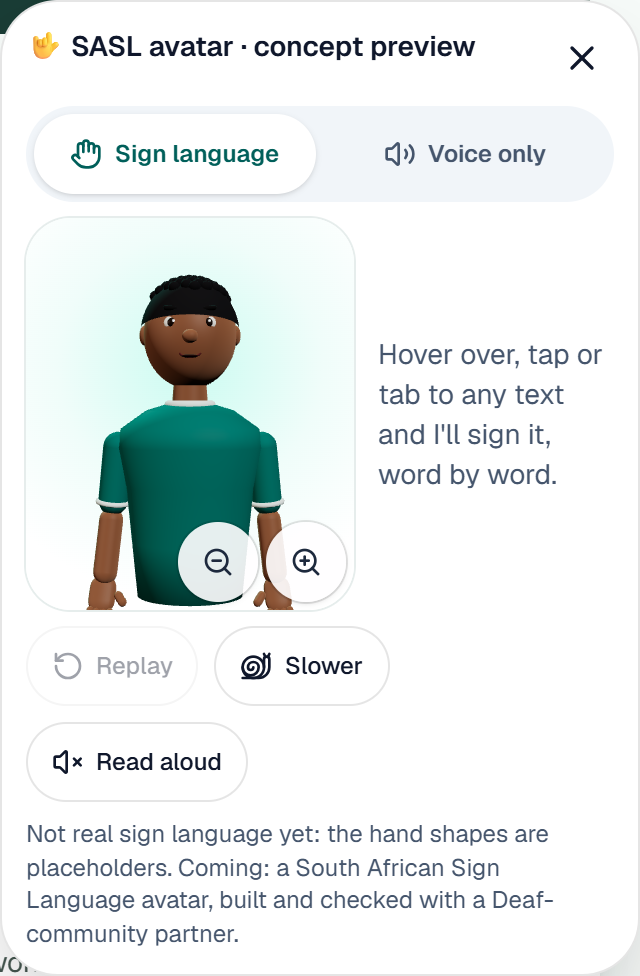
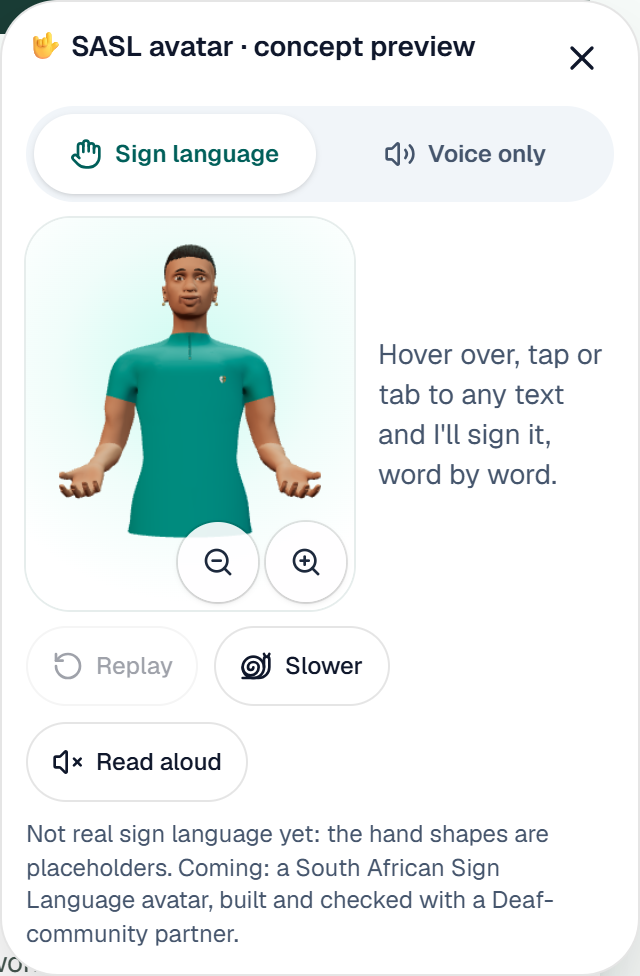
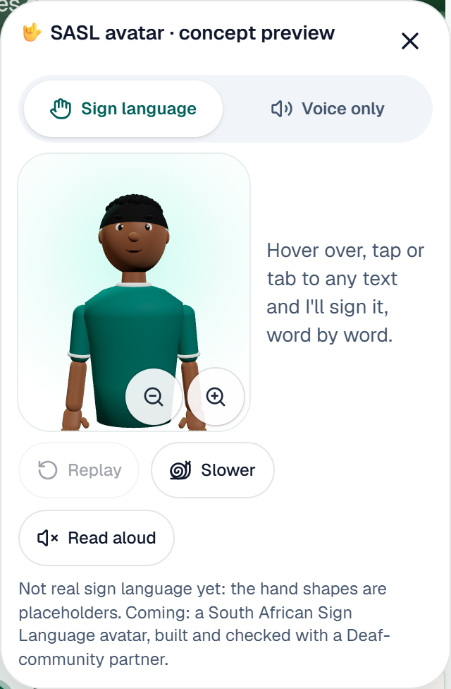
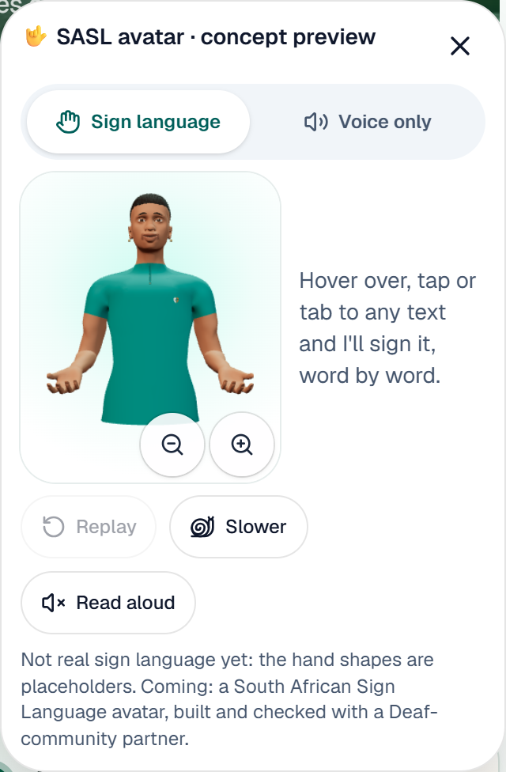

# Avatar V2 in the existing Gcina panel

The before captures use `main` at `1dd6238`. The after captures use
`feat/integrate-avatar-v2-only` with the same mock dashboard data and viewport.
Both captures use the system reduced-motion setting so the two characters are
shown at rest. Open the dashboard and select the existing teal hand launcher
to see the animated version.

| Viewport | Before | After |
|---|---|---|
| Desktop, 1440 × 900 |  |  |
| Mobile, 390 × 844 |  |  |

[Desktop dashboard](desktop-in-dashboard.webp) · [Mobile dashboard](mobile-in-dashboard.webp)

Both panel captures had identical dimensions, labels and control positions.
Pixel comparison found zero changes outside the 164 × 196 avatar stage on
desktop and mobile. The V2 character stays inside that stage with both hands
visible and the existing zoom buttons below them. Close-up meshes still show
the wrist crease visible in the source avatar.

## Verification

| Check | Result |
|---|---|
| ESLint and TypeScript | Passed |
| Character tests | 4/4 passed. Checks cover all ten digits, framing and readable hand placement at existing zoom sizes, jaw movement with speech, reduced-motion stillness and resource disposal. |
| Production build | Next.js 16.4.6 Webpack build passed with Tailwind CSS 4.3.3 via a temporary local PostCSS adapter and cached official Geist fonts. The default Turbopack run failed resolving the cached Google Font files on Windows. |
| Chrome desktop and mobile | Passed for launcher, Sign language/Voice only, keyboard and touch selection, highlighting, Replay/Again, Slower, four zoom sizes, 320px layout, saved voice/language/zoom preferences and the Accessibility sheet switch. |
| Speech and language | Windows Chrome completed one native English utterance and reported word boundaries. The browser fixture exercised isiZulu translation display, matching-voice selection and the text-only fallback for a missing voice. |
| 3D lifecycle | The GLB loaded in owner and judge sessions, loaded on demand in Sign language mode and recovered on reopen after a delayed load. A failed fetch and a simulated WebGL context loss displayed the existing 3D error while the panel remained usable. |

The existing interface continues to describe the motion as a SASL concept
preview. The character reuses the panel's speech state for approximate jaw
movement. Translation verification used an intercepted response, so this run
did not call the live translation provider.
