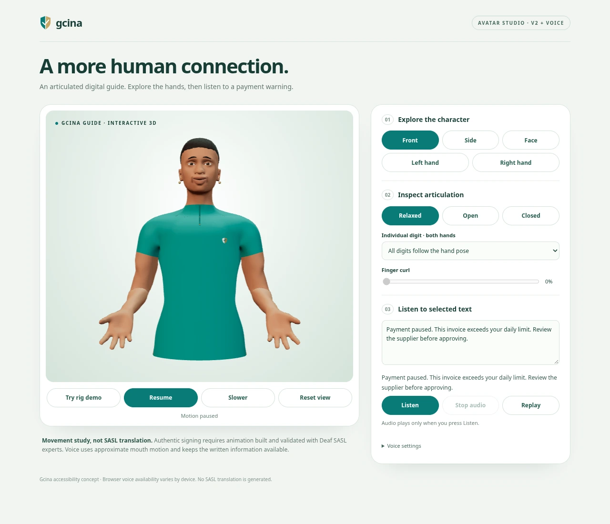
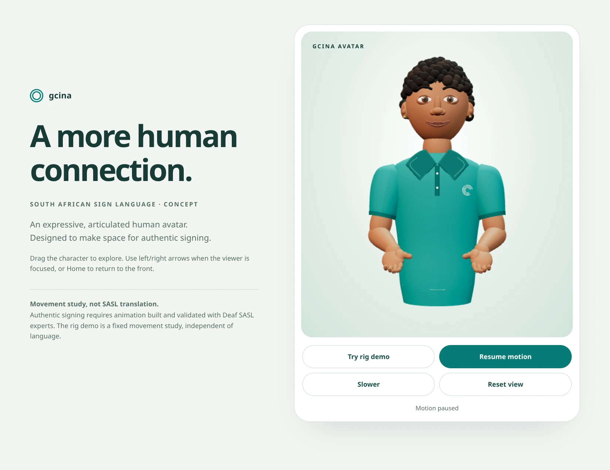

# Gcina Avatar V2 + voice

A rigged, animatable GLB replaces the V1 primitive character in the existing
accessibility panel. It has continuous anatomical hands, independent finger
chains and thumb opposition, a weighted face/jaw, textured swept hair and a teal
Gcina uniform. The existing Three.js dependency is reused; no runtime packages
were added. [Asset licence and provenance](THIRD_PARTY.md).

**Movement study, not SASL translation.** The rig demo is a fixed animation,
independent of selected words. Speech is optional browser read-aloud with
approximate jaw motion; it is not phoneme lip-sync or signing. Authentic SASL
animation and facial grammar require Deaf SASL experts and validated data.

## Open the interactive preview in Chrome

Download [preview.html](preview.html) from this branch, then open the downloaded
file in Chrome. It contains the actual GLB, renderer and controls in one file;
GitHub's HTML source viewer does not execute it. If your browser blocks local
files, serve it from the repository root:

```sh
python3 -m http.server 8000 --directory docs/avatar
# Open http://localhost:8000/preview.html
```

Use **Front / Side / Face / Left hand / Right hand**, inspect **Open / Relaxed /
Closed**, select an individual digit and change its curl. Drag or use arrow keys
to turn; Home/reset restores the view. The lower controls provide rig demo,
pause/resume and slower motion. The preview respects reduced motion, including
preference changes while open. Explicit, manual pose/view changes remain usable.

Enter a payment warning and press **Listen**. The text stays available throughout
playback. **Pause/Resume**, **Replay** and **Stop audio** control the same utterance.
Voice settings list the browser's available voices and speech speeds. Installed
South African English (`en-ZA`) is preferred when available; a particular voice
or naturalness cannot be guaranteed across devices. With an empty list, Listen
tries the system default and reports a useful error if playback cannot start.

The character preview needs no network. Some browser-provided speech voices may
use their provider's network service. No backend TTS service is added by Gcina.

## Actual visual previews

[Full character](v2/full-character.webp) · [Face](v2/face.webp) ·
[Left open](v2/left-open.webp) · [Left closed](v2/left-closed.webp) ·
[Right open](v2/right-open.webp) · [Right closed](v2/right-closed.webp) ·
[Side profile](v2/side.webp) · [Dashboard](v2/desktop.webp) ·
[Mobile dashboard](v2/mobile.webp) · [Mobile studio](v2/studio-mobile.webp)



| V1 baseline | V2 implementation |
|---|---|
|  |  |
| Separate rounded palm/finger meshes | One connected weighted skin surface per hand |
| Primitive face and instanced hair balls | Anatomical facial mesh, eyelid/brow/jaw bones and shaped hair |
| Reading flow only | Written flow plus explicit, optional browser speech |
| Four core controls | Same controls, consolidated with Listen/Stop for mobile |
| Procedural transform hierarchy | 163-bone GLB with named arm, hand and facial controls |

All images are captures of the running implementation, converted to WebP. They
are not generated concept art. Both hands were inspected in open and closed
poses. See [verification.md](verification.md) for tests and practical limits.

## Run Gcina locally

From the repository root, using Node 24 and pnpm:

```sh
git switch feat/avatar-v2-voice
cd web
pnpm install --frozen-lockfile
USE_MOCK=1 \
DASHBOARD_PASSCODE=gcina-local-demo \
SESSION_SECRET=gcina-local-preview-only-session-key-2026 \
pnpm dev
```

These are **local mock example values**, not production credentials. Open
`http://localhost:3000`, sign in with `gcina-local-demo`, and open the floating teal
hand button. No financial dashboard, policy, payment-agent or blockchain code
was changed. Existing real-service configuration still works.

Hover over text, tap it, or focus a link/button. Text selection never starts
speech. Press Listen explicitly. A new selection stops the previous utterance.
Replay repeats audio after Listen has been used, or repeats the original written
reading flow otherwise. Pause freezes reading, speech and avatar motion; Stop
stops audio. Slower affects the reading pace and the next speech request. Changing
voice/speed stops active speech and requires another explicit Listen. Closing or
unmounting cancels owned speech and releases the viewer.

Spoken highlights use reliable browser **word-boundary events only**. When those
are absent, the full text stays visible with a timing-unavailable message; the
app does not simulate word timing. Reduced motion suppresses idle, blink, rig and
mouth animation while allowing explicitly requested audio. The panel remains
nonmodal, keyboard accessible and optional. WebGL failure leaves text and voice
controls available. Small/landscape screens can scroll the panel when necessary.

## 10–15 second presentation

1. Open the avatar and select a short payment-warning message (about 3 seconds).
2. Press **Listen**; let the warning play with approximate mouth movement
   (about 6–8 seconds). Written text remains on screen.
3. Press **Rig demo** and briefly drag the avatar (about 3 seconds).

Use the standalone sample if no warning is available in the dashboard. Before
presenting, choose and audibly check a voice in Chrome on the presentation laptop.
The managed Linux test browser had **no installed speech voices**, so audible
native playback could not be verified there. The voice wiring, cancellation and
word timing were tested with a deterministic browser speech double, and the
native empty-voice failure path was tested separately.

## Character and animation interfaces

`await createAvatar(source?, signal?)` loads `/avatars/gcina-v2.glb` by default,
or accepts an ArrayBuffer for an offline/test preview. Loading is now asynchronous;
scene ownership stays synchronous through `createAvatarScene(...).ready`. Abort,
close-during-load, retry, GPU loss and resource teardown are handled explicitly.

The familiar `root`, `chest`, `head`, `eyes`, `brows`, `mouth`, `left`, `right`,
`poseArm`, `update` and `dispose` handles remain. They now expose actual `Bone`
objects. The source skeleton includes intermediate forearm/metacarpal joints;
elbow/wrist/digits are descendants rather than necessarily direct children.
Character left/right are anatomical sides. Up is +Y, front is +Z; rotations are
radians and curl inputs are clamped to 0–1.

- `poseArm(arm, { shoulder, elbow, wrist, curls })` uses bind-relative XYZ rotations;
  curls remain ordered **index, middle, ring, little, thumb**.
- `setFinger(arm, name, curl)` addresses one digit. Four fingers have three
  phalanges. The thumb has two phalanges plus its own opposition joint.
- `update(seconds, demo, still, speechEnvelope?, inspection?)` supplies neutral
  posture, breathing, eyelid blink, the fixed movement study and approximate jaw
  movement. Inspection supports relaxed/open/closed and per-digit overrides.
- `bounds('head' | 'left' | 'right')` measures the **deformed skin**, not empty bone
  handles. `bones` and `meshes` expose the underlying rig for later animation work.
- Stable bone names include `upperarm01.L`, `lowerarm01.L`, `wrist.L`,
  `finger2-1.L` (index proximal), `finger1-1.L` (thumb CMC), `head` and `jaw`.

Future validated animation should replace the procedural update or apply its
tracks afterward; otherwise that update will overwrite the same joints. This
rig has facial bones, not a complete viseme/morph-target library. The included
pose presets are constrained demonstrations, not a general collision solver or
SASL training data. Retargeting and nonmanual signing grammar still need expert
validation.

Three.js and the GLB load only after the panel opens. The renderer caps at 30 fps,
limits pixel density, stops offscreen/hidden/paused/reduced-motion work, and
adapts to a slow renderer. Its fallback computes the same weighted skin surface
in dynamic buffers and uses cheaper diffuse studio materials. Hardware rendering
uses PBR materials. All owned geometry, materials, skeleton textures, observers,
listeners, scheduled frames and the WebGL context are disposed on close.

## Rebuild and test

The checked-in model works without Blender. To edit/rebuild it, use Blender 4.3.2
and the [pinned source assets](../../web/assets/avatar-source/README.md):

```sh
blender --background --python web/scripts/build-avatar-model.py
```

Rebuild the self-contained HTML after changing model/scene/preview code:

```sh
npm install --prefix /tmp/gcina-preview-tools --no-save esbuild
ESBUILD_MODULE=/tmp/gcina-preview-tools/node_modules/esbuild/lib/main.js \
node web/scripts/build-avatar-preview.mjs
```

Core checks from `web/`:

```sh
pnpm lint
pnpm exec tsc --noEmit
pnpm build
node --test tests/avatar-rig.test.mjs tests/avatar-hands.test.mjs tests/avatar-speech.test.mjs
```

Tests use Node's TypeScript stripping (Node 24 recommended). The module-type
warning on direct TS imports is harmless; package build settings are unchanged.

Optional browser tools stay outside the application dependency tree:

```sh
npm install --prefix /tmp/gcina-browser-tools --no-save playwright
/tmp/gcina-browser-tools/node_modules/.bin/playwright install chromium
export PLAYWRIGHT_MODULE=/tmp/gcina-browser-tools/node_modules/playwright
export AVATAR_TEST_PASSCODE=gcina-local-demo
# Keep the local mock app running; from web/:
node scripts/verify-avatar.mjs
node scripts/verify-avatar-voice.mjs
# Serve docs/avatar on port 8000 as above:
node scripts/verify-avatar-preview.mjs
```

Optional settings: `AVATAR_BASE_URL`, `AVATAR_PREVIEW_URL`, `AVATAR_CAPTURE_DIR`,
`CHROMIUM_PATH` and `AVATAR_SOFTWARE_GPU=1` for headless SwiftShader. The browser
scripts cover real rendered output, input, cleanup and accessibility. Speech
integration explicitly reports which tests use a double and lists native voices.

This branch is for review against `feat/polished-sasl-avatar`. Nothing is merged
into main or deployed to production.
