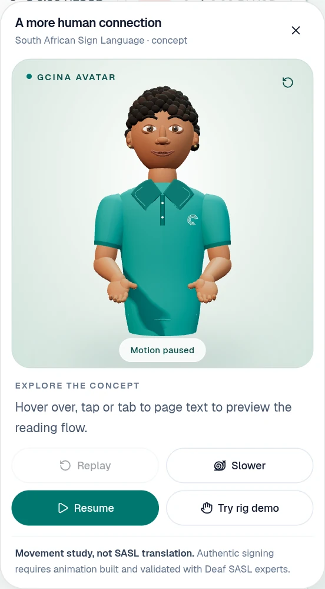

# Gcina avatar concept

A custom, interactive Three.js human character for the existing SASL concept panel. This is an original procedural model with a hierarchical transform rig, not an imported GLB. No runtime dependency, remote asset, texture download or licence attribution is required for the character.

**This does not translate South African Sign Language.** Text selection demonstrates a reading flow. The optional **Try rig demo** button plays the same gentle range-of-motion study for all text. There is no invented vocabulary, number fingerspelling or text-driven mouthing. Authentic signing, timing and facial grammar need Deaf SASL experts and validated animation data.

## Preview

The standalone `preview.html` embeds the same scene and rig used by the application and makes no external requests. Download it first if viewing on GitHub. You can open it directly where browser policy allows local files, or serve it locally:

```bash
python3 -m http.server 3002 --directory docs/avatar
# Open http://localhost:3002/preview.html in Chrome.
``` The standalone preview has view, motion and rig controls. The actual application integration is shown in the captures below.



[Standalone preview capture](standalone.webp) · [Desktop capture](desktop.webp) · [Mobile capture](mobile.webp) · [Rig demonstration](rig-demo.webp) · [Reduced motion](reduced-motion.webp)

## Run the application

Use Node 24 LTS and pnpm. From the repository root:

```bash
git switch feat/polished-sasl-avatar
cd web
pnpm install --frozen-lockfile
USE_MOCK=1 \
DASHBOARD_PASSCODE=avatar-local-demo \
SESSION_SECRET=local-avatar-preview-secret-at-least-32-characters \
pnpm dev
```

These example credentials are for local mock testing only. Open `http://localhost:3000`, sign in with `avatar-local-demo`, then open the teal hand button at the bottom right. Existing real-service settings can be used instead; no backend changes are needed.

- Hover over page text, tap it, or focus a link/button to select it.
- Replay and Slower retain the existing reading flow. Pause stops both reading and character animation.
- Try rig demo enables the explicitly labelled movement study. It is independent of selected words.
- Drag horizontally to inspect the character within ±17° of the front. With the viewer focused, use Left/Right; Home or the reset icon returns to the front.
- Escape closes the panel, clears page highlights and returns focus to the launcher.
- OS/browser reduced-motion preference disables the rig demo and idle movement immediately, including when changed while the panel is open. Explicit view rotation remains available.
- Small/landscape screens can scroll within the panel to reach every control.

## Implementation

- `web/src/components/sasl-preview.tsx`: existing text picking, CSS highlights, replay/speed controls and responsive panel. The previous word-hashed gesture generator and false translation copy are removed.
- `web/src/components/sasl-avatar/rig.ts`: sculpted head, layered eyes, brows, lips, ears, instanced curls, teal polo/collar/embroidery, arms and hands. Each arm exposes shoulder, elbow and wrist transforms; each finger has three phalanges, each thumb two. Skin, nails, fabric and hair have separate PBR materials.
- `web/src/components/sasl-avatar/scene.ts`: portrait camera, warm key/cool fill/rim lighting, soft shadows, constrained rotation, visibility scheduling and explicit GPU cleanup.
- `web/src/components/sasl-avatar/viewport.tsx`: lazy scene import, loading/failure/retry UI, accessible viewer instructions and lifecycle ownership.

Three.js loads only when the preview opens. Geometry is shared; hair curls use two instanced draws. The portrait contains 52,928 triangles. Rendering is capped at 30 fps and device pixel ratio at 1.75, with a 512px shadow map. A measured slow-renderer fallback disables shadow passes and uses native pixel resolution; the rig and controls remain identical. The loop stops when paused, reduced motion is enabled, the page is hidden, or the viewport is offscreen. Closing disposes geometry, materials, instances, shadow targets and the WebGL context, and removes observers/listeners.

The UI preserves text access if WebGL fails. The selected sentence is announced once, rather than announcing every highlighted word. The panel is a nonmodal complementary region: the rest of the application remains keyboard accessible.

## Future authentic SASL animation

`createAvatar()` returns named `head`, `eyes`, `brows`, `mouth`, `chest`, `left` and `right` controls. Side names are the character's anatomical sides. Units are arbitrary scene units; the character faces +Z, up is +Y. Angles are radians; finger curl values are normalised control inputs.

`poseArm(arm, pose)` accepts shoulder/elbow/wrist XYZ rotations and five curls in **index, middle, ring, little, thumb** order. Each finger joint is separately accessible for future spread, opposition and phalange-specific motion. Direct group tracks can use stable names such as `shoulder.R`, `wrist.L` and `index.02.R`.

The current `update()` method supplies idle and demo animation. A future animation driver must replace that arm update or apply validated poses after it; otherwise idle will overwrite supplied arm transforms. Facial groups are available, but this procedural character has no full facial blendshape set or skinned deformation. A production signing rig may need skinning, facial morph targets, collision constraints and retargeting. Do not treat the movement study as training data or a signing implementation.

## Checks

```bash
cd web
pnpm lint
pnpm exec tsc --noEmit
pnpm build
node --test tests/avatar-rig.test.mjs
```

The rig tests require Node 22.18+ (native TypeScript stripping), with Node 24 used for verification. Node may print a harmless module-type detection warning for the directly imported TS file; application build settings are unchanged.

The four rig tests check independent anatomical chains, camera containment of the head and hands through the movement study/rotation range, reduced-motion stability/blinking/breathing, and geometry budget/resource disposal.

For browser checks, keep the local mock app running, then in another terminal from `web`:

```bash
# Optional test tools live outside the application dependency tree.
npm install --prefix ../work/avatar-test-tools --no-save playwright
../work/avatar-test-tools/node_modules/.bin/playwright install chromium
PLAYWRIGHT_MODULE="$PWD/../work/avatar-test-tools/node_modules/playwright" \
AVATAR_TEST_PASSCODE=avatar-local-demo \
node scripts/verify-avatar.mjs
```

The script captures the real app and checks desktop/mobile/landscape layouts, touch and keyboard text selection, replay/speed/pause, rotation/reset, reduced-motion changes, WebGL failure/retry and repeated open/close cleanup. Set `AVATAR_CAPTURE_DIR` to choose the capture folder, `AVATAR_BASE_URL` for another local port, and `CHROMIUM_PATH` to use an installed Chrome/Chromium executable. `AVATAR_SOFTWARE_GPU=1` enables SwiftShader in headless environments.

## Verification record

To rebuild the standalone preview after changing the rig/scene, install esbuild into a scratch tools directory (it is not an app dependency):

```bash
# From the repository root:
npm install --prefix work/avatar-preview-tools --no-save esbuild
ESBUILD_MODULE="$PWD/work/avatar-preview-tools/node_modules/esbuild/lib/main.js" \
node web/scripts/build-avatar-preview.mjs
```

See `verification.md` for the completed run and environment limitations. Preview assets are captures of the actual implementation, not generated concept art.
